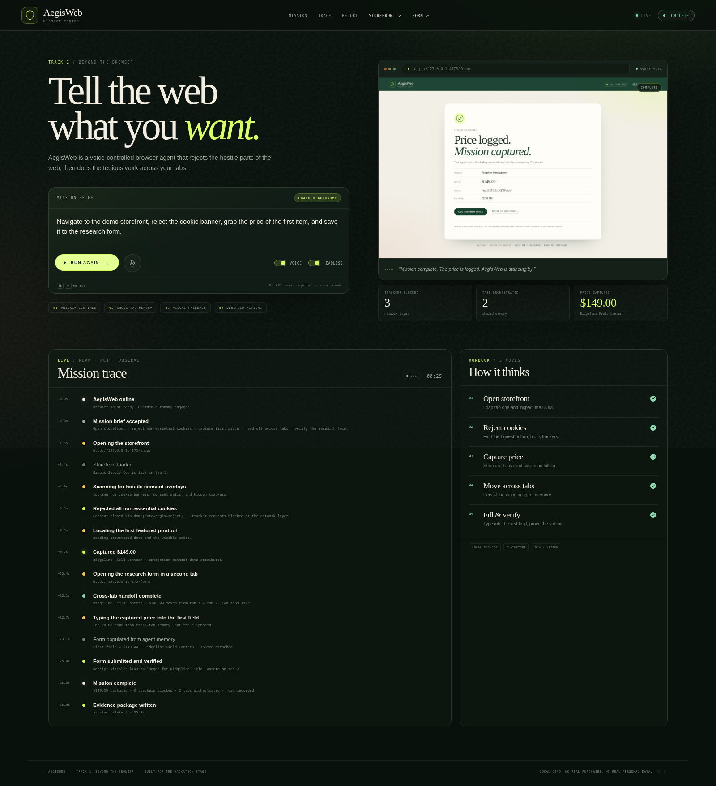
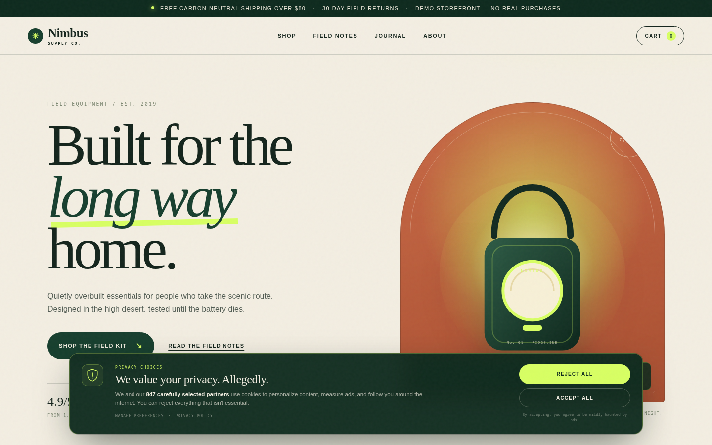
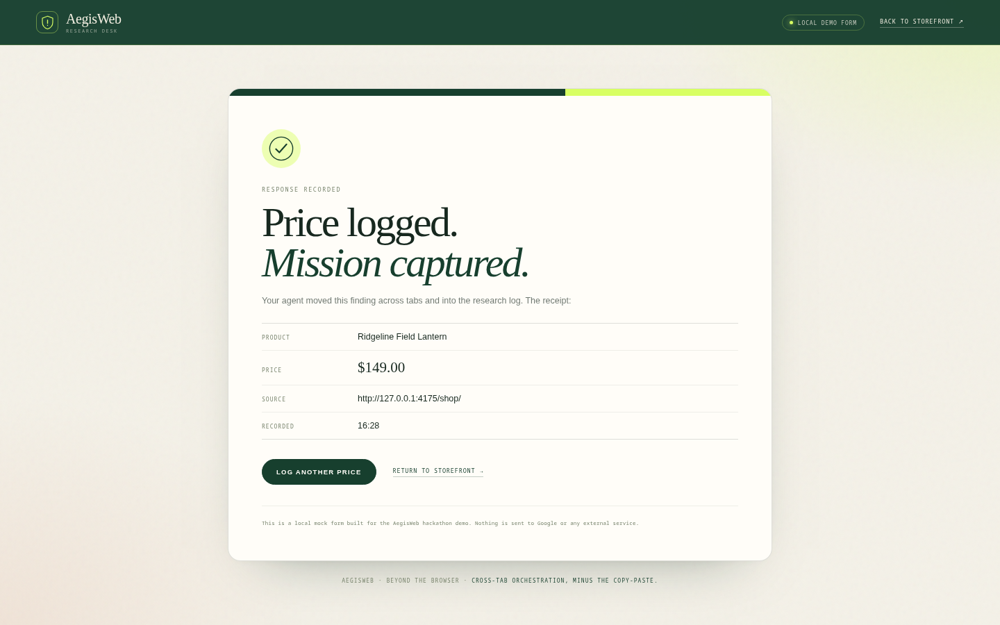

# AegisWeb

**Tell the web what you want. AegisWeb handles the hostile parts, then does the tedious work across your tabs.**

AegisWeb is a local-first browser agent built with Python and Playwright for the
*Beyond the Browser* hackathon track. It opens a real storefront, rejects the cookie
banner, blocks tracker requests, captures the first product's price, carries that
value across tabs, and verifies a form submission — all in one recorded run.

The stage demo is deterministic and offline. **No API keys, no cloud account, and
no network access are required.**



## The 60-second demo

One mission brief:

> *Navigate to the demo storefront, reject the cookie banner, grab the price of the first item, and save it to the research form.*

AegisWeb then:

1. Opens **Nimbus Supply Co.**, a local storefront with a deliberately hostile consent banner.
2. Clicks **Reject all** — not "Accept" — and aborts tracker requests at the network layer.
3. Reads the first featured product and captures **$149.00**.
4. Opens a second tab, the **Product Price Watch** form, and moves the price from tab 1's memory to tab 2.
5. Types the price into the first field, submits, and proves the receipt is visible.

Every action is a real browser action with a real verification, streamed live to
Mission Control and saved as an evidence package.

<p align="center">
  
  
</p>

## Quick start

### Requirements

- Python 3.10+
- Google Chrome, Chromium, or Brave (auto-detected)
- Linux, macOS, or Windows

### Run Mission Control

```bash
cd webx
python3 -m pip install -r requirements-dev.txt
./run_demo.sh
```

`run_demo.sh` installs missing Python packages, starts the local demo server, and
opens **http://127.0.0.1:8000**. Click **Run mission**.

> If system Chrome is not installed, run `python3 -m playwright install chromium`
> once. You can also point at a specific binary with `AEGIS_CHROME_PATH`.

### Run the agent from the terminal

```bash
python3 -m aegisweb doctor
python3 -m aegisweb demo                 # headed, paced for a recording
python3 -m aegisweb demo --headless --slowmo 0 --pace 0 --no-narration
```

### Run the standalone happy path

`scripts/happy_path.py` is a single-file Playwright script for a quick, independent
proof. It starts its own server and imports none of the AegisWeb package.

```bash
python3 scripts/happy_path.py            # headed, with completion audio if configured
python3 scripts/happy_path.py --headless
```

## What you get

Each run replaces `artifacts/latest/` with a self-contained evidence package:

| Artifact | Contents |
| --- | --- |
| `01-storefront-loaded.png` … `06-submission-verified.png` | Six screenshots of the verified flow |
| `report.md` | Human-readable outcome, trace table, embedded evidence |
| `run.json` | Mission, result, and every structured event |
| `trace.jsonl` | Append-only event stream for replay or analysis |
| `memory.json` | Cross-tab facts and handoff record |

The dashboard exposes the same files at `/artifacts/latest/report.md` and streams
events from the agent over Server-Sent Events.

## How it works

AegisWeb uses a **guarded runbook**: a bounded Plan → Act → Observe loop with a
verification after every meaningful action. This is a deliberate choice for a live
demo — deterministic where the page is known, resilient where it is not.

```
Mission brief
    │
    ▼
┌─────────────┐   ┌──────────────┐   ┌──────────────┐   ┌──────────────┐
│ Parse brief │──▶│ Browser tab 1│──▶│ Cross-tab    │──▶│ Browser tab 2│
│ URLs+intent │   │ consent+price│   │ memory       │   │ fill+verify  │
└─────────────┘   └──────────────┘   └──────────────┘   └──────────────┘
                          │                  │                  │
                          └──────────── EventBus ───────────────┘
                                  │       │       │
                              terminal   SSE   report / trace
```

### Reliability ladder

Each skill tries the cheapest reliable strategy first:

| Step | Strategy |
| --- | --- |
| Consent | `data-aegis-reject` → common banner IDs → accessible role/text → DOM walker → optional vision → last-resort local intervention |
| Price | `data-*` attributes → price selectors → JSON-LD `Product` → body text regex |
| Form | labelled fields → first `form` input → submit button → `requestSubmit()` fallback |
| Verification | Page state and receipt text, never a sleep-and-hope |

Consent and price extraction are exercised by the local demo. The vision fallback is
an optional escape hatch for redesigned external sites and needs an OpenAI or
Anthropic key.

### Privacy sentinel

- Routes matching tracker patterns (`/track/`, Google Analytics, DoubleClick,
  Meta, Hotjar, Segment, Amplitude, Mixpanel) are aborted before they load.
- The demo page also contains three local tracker requests, so the blocked count is
  real and visible in the UI.
- The agent clicks the honest **Reject all** control and verifies the resulting
  consent state before continuing.
- The demo storefront and form are local static files. No CDN, font, analytics, or
  purchase flow leaves the machine.

### Cross-tab orchestration

The price is stored in `AgentMemory` (JSON on disk) as a fact with a source label,
then recorded as a handoff from `storefront` to `research-form`. The second tab reads
from memory, not the clipboard. The same interface can mirror runs to DynamoDB; see
[`infra/README.md`](infra/README.md).

### Phantom-style runs

The dashboard's **Headless** toggle runs the browser without a visible window while
keeping the same live screenshots and trace. Use it for CI, a clean projection, or a
"phantom" run where only the agent's view is visible.

## Feature map

| Blueprint idea | Implementation |
| --- | --- |
| Privacy sentinel | Network-level tracker blocking + consent rejection + verified state |
| Bureaucracy buster | Typed form completion, submit, receipt verification |
| Cross-tab orchestration | Shared agent memory with explicit, auditable handoffs |
| Self-healing visual reasoning | Layered DOM/ARIA fallbacks plus optional OpenAI/Anthropic vision click |
| Multi-step planning | Parsed mission brief, five-phase runbook, live plan/act/observe trace |
| Phantom mode | Headless execution with the same evidence and screenshots |
| Voice control | Dashboard speech synthesis + dictation (where the browser supports it) |
| Cloud memory | Optional SAM stack: HTTP API → Lambda → DynamoDB |

## Voice

The dashboard narrates with the browser's built-in `SpeechSynthesis` — no key and no
network. Toggle **Voice** off for a silent run.

For a studio voice, AegisWeb supports ElevenLabs:

```bash
export ELEVENLABS_API_KEY=...          # placeholder in .env.example
python3 scripts/generate_tts.py        # writes assets/voice/*.mp3
python3 -m aegisweb demo --audio
```

You can also drop your own `complete.mp3` into `assets/voice/` and run with
`--audio`. The completion hook also checks `AEGIS_COMPLETION_AUDIO`. Missing audio
never affects mission success; the demo degrades to silence.

## Optional integrations

All integrations are opt-in and fail soft. The core demo never waits on them.

| Integration | Variable | Used for |
| --- | --- | --- |
| OpenAI vision | `OPENAI_API_KEY` | Last-resort control location on redesigned sites |
| Anthropic vision | `ANTHROPIC_API_KEY` | Same, Claude vision |
| ElevenLabs | `ELEVENLABS_API_KEY` | Pre-rendered or on-demand narration |
| AWS run memory | `AEGIS_CLOUD_URL` | Optional run sync to API Gateway/Lambda/DynamoDB |

Copy [`.env.example`](.env.example) to `.env` only if you need them.

Deploy the optional cloud memory:

```bash
cd infra
sam build
sam deploy --guided
# then set AEGIS_CLOUD_URL to the RunsEndpoint output + /runs path
```

Details, API contract, and cleanup are in [`infra/README.md`](infra/README.md).

## Commands

| Command | Purpose |
| --- | --- |
| `python3 -m aegisweb serve` | Mission Control dashboard + demo server |
| `python3 -m aegisweb demo` | Headed agent run in the terminal |
| `python3 -m aegisweb demo --headless --pace 0` | Fast deterministic run |
| `python3 -m aegisweb doctor` | Check Python, browser, dependencies, keys |
| `python3 -m aegisweb tts --dry-run` | Preview the ElevenLabs script |
| `python3 scripts/happy_path.py` | Standalone end-to-end proof |
| `make test` | Full test suite |

Useful demo flags: `--task`, `--base-url`, `--port`, `--slowmo`, `--pace`, `--hold`,
`--audio`, `--no-narration`.

## Tests

```bash
python3 -m pytest -q
```

The suite covers mission parsing, a headless end-to-end run with artifacts and memory
assertions, and the dashboard's health/validation/run API. Browser tests skip
cleanly if no Chrome/Chromium is available.

## Project layout

```
aegisweb/
  agent.py          # Plan → Act → Observe runbook
  browser.py        # Playwright context, tracker blocking, cursor, screenshots
  skills.py         # Consent, extraction, form fill, verification
  memory.py         # Cross-tab facts and handoffs
  events.py         # Thread-safe event bus → terminal / SSE / trace
  dashboard.py      # FastAPI API, SSE stream, run runner
  dashboard/        # Mission Control UI
  demo_server.py    # Zero-dependency local static server
  voice.py          # ElevenLabs / local audio hook
  llm.py            # Optional vision fallback
  report.py         # report.md + run.json
demo/
  shop/             # Nimbus Supply Co. storefront
  form/             # Product Price Watch research form
scripts/
  happy_path.py     # Standalone single-file demo
  generate_tts.py   # ElevenLabs voice pack
tests/
docs/
infra/              # SAM + Lambda + DynamoDB run memory
```

## Honest scope

AegisWeb is not a general-purpose autonomous web agent, and it does not pretend to
be. The recorded flow is a guarded runbook tuned to a local storefront and form; it
is built to be understandable, observable, and extremely hard to break on stage.

What is real: browser control, network blocking, DOM extraction with fallbacks,
cross-tab state, form submission, verification, live telemetry, evidence capture,
and an optional cloud path. What is bounded: the planning is a parsed brief plus a
fixed five-phase runbook, and the public demo does not attempt arbitrary purchases,
logins, or CAPTCHA solving. The optional vision model can click unfamiliar controls,
but it is deliberately not on the critical path.

## Docs

- [Architecture](docs/ARCHITECTURE.md) — components, event flow, fallbacks, tradeoffs
- [Hackathon runbook](docs/HACKATHON.md) — 3-minute script, pitch, Q&A, failure recovery
- [AWS run memory](infra/README.md) — deploy, API contract, security, cleanup

## License

MIT. See [LICENSE](LICENSE).
