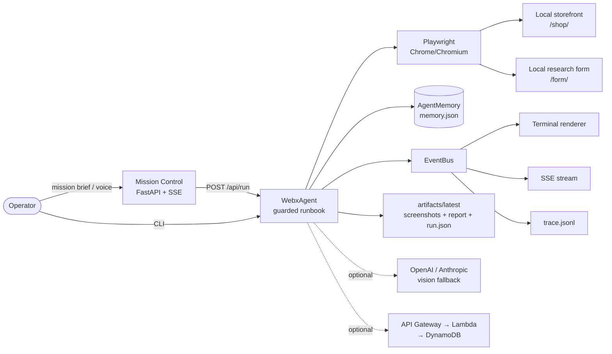
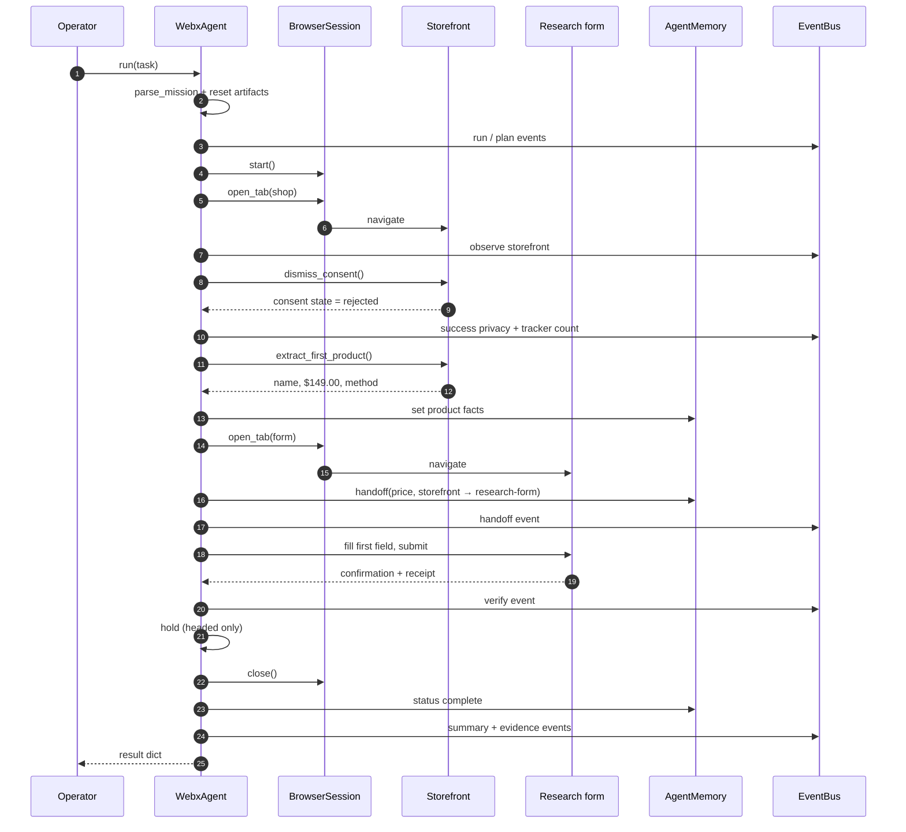

# Webx architecture

> A local-first browser agent with a guarded runbook, observable actions, and an
> optional cloud mirror. This document describes what actually ships in the repo.

## 1. Design goals

| Goal | Decision |
| --- | --- |
| Reliable on stage | Deterministic selectors on local pages, verification after every action, no external assets |
| Inspectable | One structured event stream feeds terminal, dashboard, trace, and report |
| Honest autonomy | Bounded five-phase runbook; optional vision fallback instead of an LLM on the critical path |
| Privacy by default | Tracker requests aborted at the network layer; local data only; optional integrations fail soft |
| Cheap to run | Python + Playwright + a stdlib demo server; AWS is optional and pay-per-request |
| Hackathon-complete | Live UI, voice, evidence, tests, docs, and a deployable cloud path |

**Non-goals for the recorded demo:** arbitrary shopping, logins, payments, CAPTCHA
solving, and fully autonomous planning. The agent is deliberately scoped.

## 2. System context



Nothing in the solid path requires the internet. Dashed paths are opt-in.

## 3. Components

| Component | File | Responsibility |
| --- | --- | --- |
| CLI | `webx/cli.py` | `demo`, `serve`, `doctor`, `tts` commands; flags and diagnostics |
| Agent | `webx/agent.py` | Mission lifecycle, five phases, narration, hold, report and cloud hooks |
| Browser session | `webx/browser.py` | Chrome detection, context, tracker routing, cursor overlay, screenshots |
| Skills | `webx/skills.py` | Consent rejection, price extraction, form fill and verification |
| Mission parser | `webx/mission.py` | Extracts URLs and intent from the brief; applies local defaults |
| Memory | `webx/memory.py` | Thread-safe JSON facts, run ID, explicit cross-tab handoffs |
| Events | `webx/events.py` | Thread-safe append-only event log with live callback and trace file |
| Dashboard | `webx/dashboard.py` | FastAPI app, state, run lock, SSE, artifact/static mounts |
| Dashboard UI | `webx/dashboard/` | Mission Control, live trace, metrics, runbook, voice |
| Demo server | `webx/demo_server.py` | Stdlib static server for `demo/`, health endpoint, free-port fallback |
| Report writer | `webx/report.py` | `report.md` with trace/evidence and `run.json` |
| Voice | `webx/voice.py` | ElevenLabs synthesis, local clip playback, graceful silence |
| Vision | `webx/llm.py` | Optional screenshot → click-point fallback |
| Cloud memory | `webx/cloud.py` | Best-effort POST of a compact run record to AWS |
| Infrastructure | `infra/` | SAM template, Lambda handler, deploy docs |
| Standalone proof | `scripts/happy_path.py` | Independent single-file Playwright flow |

## 4. Run lifecycle



### Phases

| Phase | Action | Verification |
| --- | --- | --- |
| `open` | Load storefront in tab 1 | Catalog/body visible; screenshot |
| `privacy` | Find and click the reject control | Consent state rejected or banner hidden; tracker list captured |
| `extract` | Read first product card | Non-empty price normalized to currency; method recorded |
| `handoff` | Open form in tab 2, write handoff | Two live pages; value present in memory |
| `form` | Fill fields, submit | First field matches captured price; confirmation or receipt present |
| `done` | Summary, hold, evidence | Report and JSON files written |

## 5. Event model

Every event is JSON-serializable and has the same shape:

```json
{
  "seq": 7,
  "type": "agent.event",
  "kind": "extract",
  "status": "success",
  "phase": "extract",
  "title": "Captured $149.00",
  "detail": "Ridgeline Field Lantern · extraction method: data-attributes",
  "data": {"price": "$149.00", "price_value": 149.0, "tab": 1},
  "narration": "Captured $149.00 ...",
  "shot": "latest/03-price-captured.png",
  "ts": "2026-11-24T20:00:03.120+00:00",
  "clock": "20:00:03",
  "elapsed": 3.12
}
```

Kinds in the current runbook: `run`, `plan`, `action`, `observe`, `success`,
`extract`, `handoff`, `verify`, `warn`, `error`, `cloud`.

One `EventBus` instance fans out to:

1. **Terminal** — colorized, human-readable progress.
2. **Dashboard** — SSE at `GET /api/events`, replaying history by sequence number.
3. **Trace file** — `artifacts/latest/trace.jsonl`.
4. **Report** — the final `report.md` renders the same history as a table.
5. **`run.json`** — full mission, result, and event list.

Callbacks are wrapped in a guard: a broken UI never takes down the agent.

## 6. Reliability and fallback ladder

### Consent

```
[data-webx-reject] → #reject-all → OneTrust IDs → text/role selectors
→ JS DOM walker → optional vision click → local DOM intervention
```

Success is not "the click returned". The agent verifies `window.__webxConsent`,
the document consent dataset, or the banner's hidden/display state. If a third-party
banner refuses to cooperate, it is hidden locally and the event records
`blockers: ["banner did not close normally"]`.

### Price extraction

```
[data-webx-first-product] data-price
→ visible price selectors inside the card
→ JSON-LD Product/offers
→ first currency-looking string in the body
```

Prices are normalized to `$1,234.56` and carry a numeric `price_value`. The method is
recorded in the event so the demo can show *how* the value was obtained.

### Form

```
[data-webx-first-field] → input[name=price] → #price → first form text input
```

After typing, the field is read back. Currency-symbol trimming is tolerated when the
numeric value matches. Submission is confirmed by the demo's explicit signal or by
visible confirmation text; a timeout is a failure, not a success.

### Vision fallback

`webx/llm.py` is only called when:

1. the DOM ladder failed, and
2. `OPENAI_API_KEY` or `ANTHROPIC_API_KEY` is set.

It screenshots the viewport, asks for a compact click point, clamps the coordinates,
and clicks once. Errors return `None`. The happy path never depends on it.

## 7. Cross-tab memory

`AgentMemory` is a small JSON document:

```json
{
  "run_id": "20261124-200000",
  "facts": {
    "consent": {"value": "rejected", "source": "privacy-sentinel", "at": "..."},
    "product_name": {"value": "Ridgeline Field Lantern", "source": "storefront", "at": "..."},
    "product_price": {"value": "$149.00", "source": "storefront", "at": "..."}
  },
  "handoffs": [
    {"key": "product_price", "value": "$149.00", "from": "storefront", "to": "research-form", "at": "..."}
  ]
}
```

Properties:

- Writes are lock-protected and persisted atomically enough for a single local run.
- Facts keep their source, so the report can distinguish user input, storefront, and
  form verification.
- A handoff is an explicit record, not an implicit variable. The dashboard and tests
  can assert it happened.
- The same payload shape is accepted by the optional AWS endpoint.

## 8. Dashboard

FastAPI app with a background run thread and a single-run lock.

| Route | Purpose |
| --- | --- |
| `GET /` | Mission Control UI |
| `GET /api/health` | Liveness and run state |
| `GET /api/state` | Last result, integrations, demo URLs, voice-pack presence |
| `POST /api/run` | Validate a brief and start a run (`202`), `409` if busy |
| `GET /api/events` | SSE event stream; replays history, keepalive every 12s |
| `GET /api/config` | Max task length, default brief, project root |
| `/artifacts/*` | Evidence files |
| `/static/*` | Dashboard assets |

The UI updates links to the demo origin from `/api/state`, shows phase badges and a
runbook, and speaks narration with browser `SpeechSynthesis`. The run thread owns its
own Playwright instance, which is required because sync Playwright is thread-bound.

### Concurrency

- One mission at a time per dashboard process. `POST /api/run` returns `409` if a run
  is active.
- The event bus resets at run start; the SSE stream uses `seq` to avoid duplicates.
- A crashed runner emits an `error` event and clears the lock in `finally`.

## 9. Optional AWS architecture

```mermaid
flowchart LR
    Agent[Webx agent] -->|POST /runs<br/>JSON + optional bearer| API[API Gateway<br/>HTTP API]
    API --> Lambda[Lambda<br/>Python 3.12]
    Lambda --> DDB[(DynamoDB<br/>runId hash key)]
    Client[curl / dashboard] -->|GET /runs<br/>GET /runs/{runId}| API
```

- `infra/template.yaml` defines the HTTP API, Lambda, table, CORS, and scoped IAM.
- `infra/lambda/handler.py` stores a compact run summary and serves recent runs.
- Floats are converted to `Decimal` before DynamoDB writes; responses are made plain
  JSON again.
- An optional `ApiToken` is enforced as a shared bearer token.
- Cloud sync is best-effort: `CloudMemory.sync()` catches network and HTTP failures,
  and the local report records `cloud_status` without failing the mission.

## 10. Determinism and demo hardening

Specific choices that make the recording reliable:

- **Local assets only.** The storefront, form, SVGs, CSS, and JS are files in `demo/`.
  There are no fonts, images, scripts, or API calls from third parties.
- **Stable hooks first.** The demo pages expose `data-webx-*` attributes; human
  selectors and fallbacks are secondary.
- **Chrome detection.** `browser.py` checks `WEBX_CHROME_PATH`, platform paths, and
  `PATH`, then falls back to Playwright's bundled Chromium.
- **Pacing separate from correctness.** `--pace 0 --slowmo 0` makes CI fast without
  changing any selectors; the default headed run adds pauses for an audience.
- **Screenshot settling.** Screenshots wait briefly for CSS transitions and use
  `animations="disabled"` so shots are crisp.
- **Cursor cleanup.** The agent cursor and click highlights are removed before the
  final evidence shot.
- **Hold window.** Headed runs hold the verified receipt on screen for 3 seconds by
  default (`--hold`), so the demo doesn't end on a closing window.
- **Free-port fallback.** If 4173 is taken, the demo server binds an ephemeral port.
- **Graceful optional services.** Missing keys, missing `ffplay`, a dead AWS endpoint,
  or an absent voice pack degrade to silence/local-only instead of failing.

## 11. Security and privacy

- Tracker URLs are matched and aborted in the Playwright route handler; the request
  never reaches the network in a normal run.
- The demo pages include a clear "local demo, no real purchases" notice.
- The research form never submits to a real service; JS prevents default and renders
  a local receipt.
- API keys are read from `.env`/environment and are never written to artifacts.
- The AWS Lambda validates input size, run IDs, and required fields; table access is
  scoped by a DynamoDB CRUD policy.
- No browsing history or form contents leave the machine unless the operator opts
  into cloud sync, and even then only the compact run summary is posted.

## 12. Performance

A headless run with pacing disabled completes in roughly 7–10 seconds on a laptop.
The headed dashboard run is intentionally slower (~20–30 seconds) because of
`slow_mo` and narration pauses. Screenshots are viewport-only PNGs, typically
0.4–1 MB each. The dashboard streams events every 300 ms, which is smooth
without busy-looping.

## 13. Extension points

| Want to… | Change |
| --- | --- |
| Point at another storefront | Pass URLs in the brief or use `--base-url`; extend `PRICE_SELECTORS`/JSON-LD support as needed |
| Add a new skill | Emit action/observe/verify events around a Playwright helper in `skills.py` |
| Add a new runbook phase | Add it to `agent.py`, the dashboard `PHASES` list, and the runbook markup |
| Change narration | Edit the strings in `agent.py` and `scripts/generate_tts.py` |
| Store more in the cloud | Extend `CloudMemory.payload` and the Lambda item schema |
| Add a real LLM planner | Keep the verification layer; replace the fixed phase order behind the same event contract |

## 14. Tradeoffs

- **Fixed runbook vs. open-ended planning.** Reliability and explainability win for a
  recorded hackathon demo. The mission parser still accepts custom URLs and intent.
- **Local JSON vs. a database.** Zero setup on stage; the AWS path exists for the
  "what's next" story.
- **DOM selectors vs. vision.** Selectors are faster, free, and deterministic; vision
  is an escape hatch, not the main loop.
- **Browser SpeechSynthesis vs. ElevenLabs.** Built-in voice is free, offline, and
  instant; ElevenLabs is a drop-in upgrade for the final recording.
- **No framework for the demo site.** A stdlib HTTP server removes a dependency and
  guarantees offline behavior.
